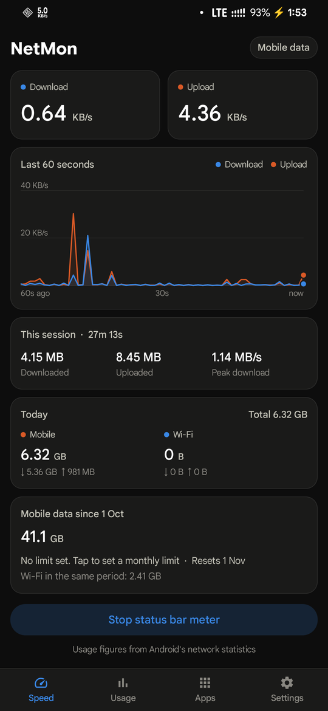
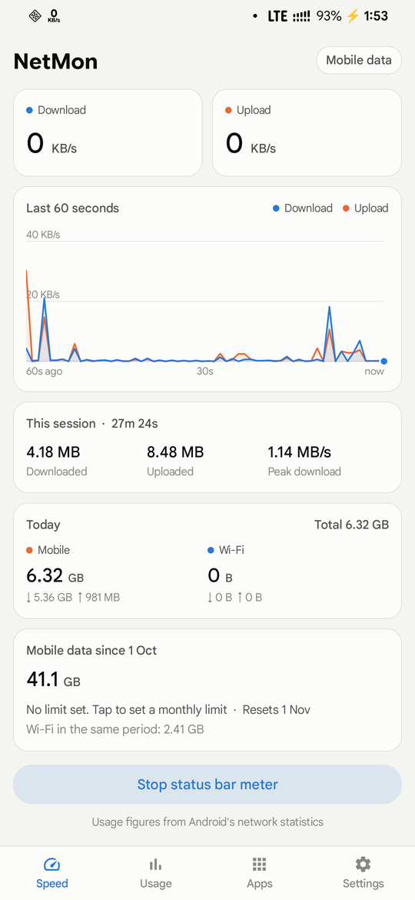
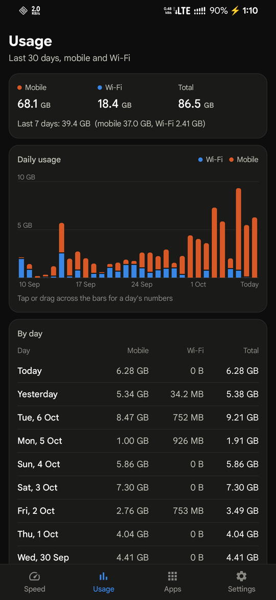
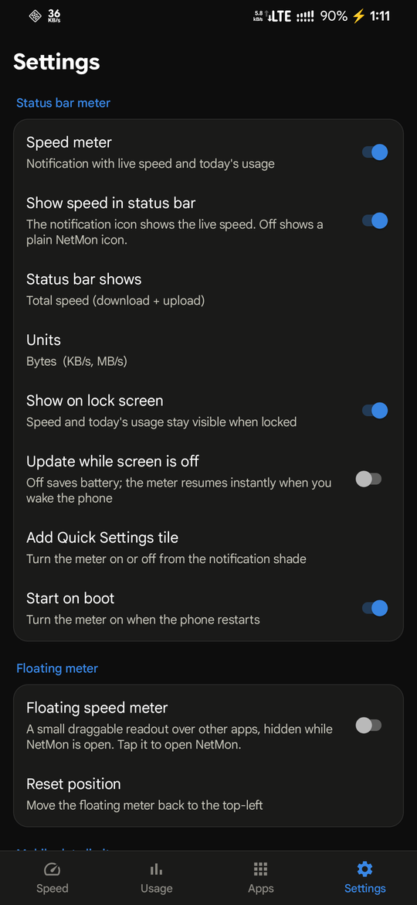

# NetMon

NetMon is a network speed meter for Android. It shows your download and upload speed in the status
bar, keeps daily mobile and Wi-Fi totals, and shows which apps use your data. It doesn't need
internet access, has no ads and no trackers, and keeps all its data on the phone.

<p>
  
  
  
  
</p>

## Features

- **Speed in the status bar.** The notification icon shows the live speed, updated every second: total,
  download or upload, in bytes (KB/s, MB/s) or bits (Kbps, Mbps). The notification shows download and
  upload speed and today's mobile and Wi-Fi usage.
- **Live speed screen.** Download and upload speed, a 60-second chart you can drag across to read exact
  values, this session's totals and peak speed, today's usage, and mobile data used in the current
  billing cycle.
- **Usage history.** Daily mobile and Wi-Fi usage for the last 30 days as a chart and a table, including
  days from before you installed NetMon.
- **Per-app usage.** Which apps used data today, in the last 7 or 30 days, or in this billing cycle,
  split into mobile and Wi-Fi.
- **Data limit alerts.** Optional monthly and daily mobile data limits. NetMon warns you at 50–90 % of a
  limit and again when you reach it. The billing cycle can start on any day from 1 to 28.
- **Floating meter.** An optional small speed readout over other apps. Drag it anywhere; tap it to open
  NetMon.
- **Quick Settings tile** to turn the meter on or off and see the speed from the notification shade.
- **Battery friendly.** By default the meter pauses while the screen is off and picks up where it left
  off when you turn it on.
- **Light and dark themes** follow the system setting.

## Install

1. Download `NetMon-<version>.apk` from the [latest release](https://github.com/RakinRkz/netmon/releases/latest).
2. Optionally, check it before installing. Its SHA-256 is in the `.sha256` file next to it. Every
   release is signed with the same key, whose certificate SHA-256 digest is:
   `a530c99d2dc02ceaa001ebf5a5eb5844da4582eba0e9a5db2d65fd40e3859523`
   To check both, run `sha256sum NetMon-*.apk` and `apksigner verify --print-certs NetMon-*.apk`.
3. Open the APK on your phone and allow installs from that source when Android asks.
4. Open NetMon and allow notifications. Then tap **Grant** to allow **Usage access**. NetMon needs it
   for accurate daily totals, history and per-app usage.

NetMon needs Android 8.0 or later. It has been tested on a Samsung Galaxy M31 with Android 16.

If the meter stops after a while, open **Settings → Battery optimization** in the app and exempt NetMon.
On Samsung phones, also check that NetMon isn't listed under the battery settings' background usage
limits (sleeping apps).

## How it measures

- **Speed.** Once a second, NetMon reads Android's traffic counters for the networks that carry
  internet traffic: mobile data, Wi-Fi and Ethernet. Traffic you share through a hotspot counts once,
  as mobile data. Traffic through a VPN counts once, on the network underneath it. Android 8 to 11
  have no per-network counters, so there NetMon uses the device-wide total, which counts hotspot and
  VPN traffic twice.
- **Usage.** With usage access, totals come from Android's own network statistics, the same data the
  system's data usage screens use, so they include history from before you installed NetMon. Without
  it, NetMon only counts while it is running.
- **Units.** Data amounts and byte speeds use steps of 1024 (KB, MB, GB). Bit speeds use steps of 1000
  (Kbps, Mbps), as network speeds are usually quoted.

## Known limitations

- Many phones offload hotspot traffic to the network hardware. Android then reports that traffic in
  batches every few seconds, so the speed moves in steps while you share your connection.
- Some phones show only a few notification icons in the status bar. Samsung phones show the 3 most
  recent by default; if NetMon's speed is missing, allow more icons in the notification settings.
- The notification stays while the meter runs, because Android requires one for a background service.
  To keep the notification without the speed in the status bar, turn off **Show speed in status bar**.
  To remove both, turn off **Speed meter**.
- Per-app usage covers the main profile only. Apps in a work profile aren't listed.
- Without usage access, "Wi-Fi" means all internet traffic that isn't mobile data, and history only
  covers the time NetMon was running.

## Permissions

| Permission | Why |
|---|---|
| Notifications | The status bar meter and data limit alerts |
| Foreground service (special use) | Keeps the meter running in the background |
| Usage access | Daily totals, history and per-app usage from Android's network statistics. You grant it in system settings. |
| View network connections | Shows which network you're on and finds the interfaces to measure |
| Query all packages | App names and icons in the per-app list |
| Display over other apps | Only for the optional floating meter |
| Run at startup | Restarts the meter after a reboot or an update |
| Ask to ignore battery optimizations | Lets you exempt NetMon from background limits |

NetMon has no internet permission.

## Build from source

NetMon is plain Java on Android framework APIs, built without Gradle using `aapt2`, `javac`, `d8` and
`apksigner`.

```sh
scripts/setup-toolchain.sh   # one-time setup, Linux x86_64: JDK 17 + Android SDK platform 35, about 1 GB
./build.sh                   # → build/NetMon.apk, signed with a local debug key
./build.sh run               # build, install over adb and launch
```

`scripts/setup-toolchain.sh` downloads the JDK from Adoptium and the SDK from Google. It accepts the
Android SDK license for you.

For a release build, run `KEYSTORE=… KS_PASS=… ./build.sh release`. It writes
`build/NetMon-<version>.apk` and its `.sha256`. [CLAUDE.md](CLAUDE.md) explains how the code is
organized.

## Contributing

Bug reports and pull requests are welcome. For a speed or usage figure that looks wrong, include your
phone model, Android version, and whether a hotspot or VPN was on.

## License

NetMon is free software under the [GNU General Public License v3.0](LICENSE). It was inspired by
Internet Speed Meter. NetMon is not affiliated with Internet Speed Meter or its developers.
